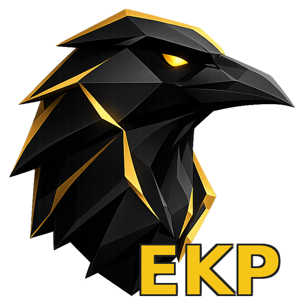

# EK-Protection

<p align="center">
  
</p>

> Terminal-based antivirus daemon for Linux — lightweight, modular, professional.

[](https://python.org)
[](LICENSE)
[]()

---

## Features (v1.0 Roadmap)

- **Real-time monitoring** — inotify-based file and process surveillance
- **On-demand scanning** — quick scan, full scan, custom path
- **Threat detection** — SHA-256 signature matching + heuristic analysis
- **Secure quarantine** — encrypted vault, full restoration capability
- **Authentication** — bcrypt password protection for critical operations
- **Exceptions system** — whitelist by path, hash, process, or extension
- **Structured logs** — SQLite + rotating files + JSON events
- **systemd integration** — auto-start on boot
- **Plugin architecture** — extend detection with custom modules
- **ClamAV integration** — optional complementary engine (Patch 10)

## Installation

### Quick install (recommended for end users)

One command, asks for nothing, sets up everything including the systemd service:

```bash
curl -fsSL https://raw.githubusercontent.com/Eviry-Studios/ek-protection/main/install.sh | sudo bash
```

### Manual install (for development)

```bash
git clone https://github.com/Eviry-Studios/ek-protection
cd ek-protection

python -m venv .venv
source .venv/bin/activate
pip install -e ".[dev]"

sudo ekp init
```

## Quick Start

```bash
# First time only: set your password
sudo ekp auth setup

# Start as a background service (survives reboot)
sudo systemctl enable --now ek-protection

# Check status
ekp status

# View configuration
ekp config show

# Set a config value
ekp config set daemon.log_level DEBUG
```

## Development

```bash
# Run tests
pytest tests/ -v

# With coverage
pytest tests/ --cov=ekprotection --cov-report=term-missing

# Lint
ruff check ekprotection/

# Type check
mypy ekprotection/
```

## Architecture

See [docs/architecture.md](docs/architecture.md) for the full component diagram and data flow.

## Patch Status

All 10 patches of the v1.0 roadmap are implemented (see [CHANGELOG.md](CHANGELOG.md)).
Work after 1.0.0 (hardening and fixes from the daily lab rounds) is listed under
`[Unreleased]` in the changelog.

| Patch | Feature | Status |
|-------|---------|--------|
| 1 | Base structure + CLI + config | ✅ |
| 2 | Authentication | ✅ |
| 3 | Logging | ✅ |
| 4 | Real-time monitor | ✅ |
| 5 | Exceptions | ✅ |
| 6 | Quarantine | ✅ |
| 7 | Scanner | ✅ |
| 8 | Heuristics | ✅ |
| 9 | Daemon IPC + systemd | ✅ |
| 10 | v1.0 stable | ✅ |

## Open-core model

EK-Protection is **open-core**. The engine is and stays MIT; what EviRyKorp
sells is the service around it. Target platform: **Linux servers and VPS
only**. There is no Windows or desktop port planned.

**Free (MIT, this repository):**

- the whole engine: daemon, real-time monitor, scanner, heuristics, quarantine,
  auth, exceptions, logs, CLI, systemd unit, plugin API, ClamAV bridge;
- the built-in heuristic rules shipped in `ekprotection/heuristics/`;
- the public signature feed in [`signatures/`](signatures/) and the feed client
  (`ekprotection/updater/`), so the free install keeps updating on its own;
- local reports (`ekp report`).

Anyone can use, fork, modify and redistribute all of this under the MIT terms,
including commercially. That includes every version already published. A paid
plan never removes or locks a feature from the engine.

**Paid (planned, not available yet):**

- a **curated signature and rule feed** with faster, more frequent updates than
  the public one, delivered over an authenticated channel;
- **support** (installation, false positives, incident follow-up);
- a **hosted panel and reports** (multi-server view, history, alerts).

The paid feed is the only part that checks a license. The license is a signed
token (Ed25519) bound to one server. If the subscription ends, the engine keeps
running with the public feed. Nothing is wiped, blocked or disabled on the
machine. Feed format and license details: [docs/FEED.md](docs/FEED.md).

There are no prices, plans or dates yet. This section describes the model,
not an offer.

## License

MIT — see [LICENSE](LICENSE). The open-core model above does not change the
license of this repository.

## Author

[EviRyKorp](https://github.com/Eviry-Studios)
